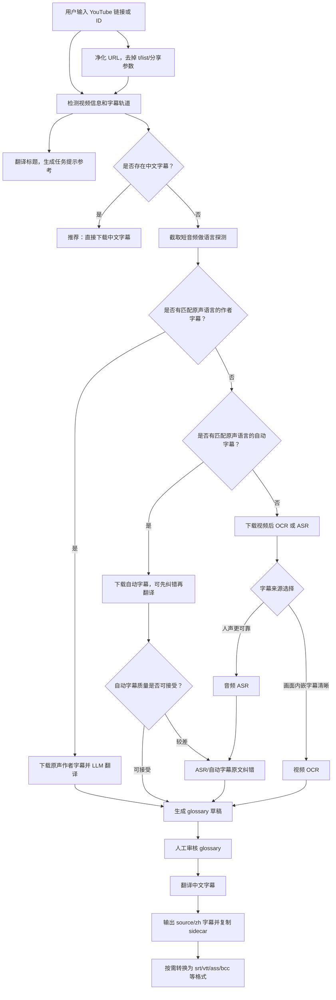

# YouTube Subtitle Agent 工作流草案

本文档用于确认“输入一个 YouTube 链接后，Agent 应该如何自动分流、提示用户决策、执行任务并产出可播放字幕”。当前项目已经具备大部分基础能力，下一步是把这些能力收束成更明确的 Agent 编排。

## 目标

用户只输入 YouTube 链接或视频 ID，Agent 自动完成检测，并根据视频资源情况给出可执行路线：

- 有作者上传字幕时，优先下载原始字幕，锁定时间轴翻译。
- 有自动字幕时，允许下载自动字幕，但提示质量风险，可先纠错再翻译。
- 没有可用字幕时，提供视频 OCR 或音频 ASR 两条路线。
- 所有路线都支持生成 glossary 草稿、人工审核术语、再进行中文翻译。
- 产物尽量复制到视频同目录，并使用播放器可自动加载的命名。

## 现有能力清单

### 链接检测

入口：

- UI: 新任务页
- API: `/api/probe`

能力：

- 解析 YouTube 链接或 ID。
- 对输入 URL 做净化，去掉播放位置、列表、分享追踪等不影响视频 ID 的杂质。
- 获取标题、时长、网页地址。
- 列出作者上传字幕和自动字幕。
- 自动盲翻视频标题，方便用户复制到任务提示词里。

### URL 净化

Agent 接收 YouTube 链接时，必须先标准化为稳定的视频 URL：

- 支持普通链接：`https://www.youtube.com/watch?v=VIDEO_ID`
- 支持短链接：`https://youtu.be/VIDEO_ID`
- 支持 Shorts：`https://www.youtube.com/shorts/VIDEO_ID`
- 支持 Embed：`https://www.youtube.com/embed/VIDEO_ID`
- 支持只输入视频 ID。

需要移除或忽略的参数：

- `t=123`、`start=123`、`time_continue=123`
- `list=...`、`index=...`
- `si=...`、`feature=...`、`pp=...` 等分享/推荐参数

标准化结果统一为：

```text
https://www.youtube.com/watch?v=<VIDEO_ID>
```

原则：

- 输入链接里的播放时间只用于用户观看，不应用来影响字幕检测、字幕下载或视频下载。
- 播放列表参数默认忽略，Agent MVP 只处理单个视频。
- URL 净化应在 `/api/probe`、下载视频、下载字幕、OCR 全流程入口都复用同一套逻辑。

### 下载字幕

入口：

- API: `/api/jobs/download-subtitle`
- 模块: `python -m video_translate.youtube.download_subtitles`
- 脚本包装: `scripts/download_youtube_subtitles.py`

能力：

- 按语言下载字幕。
- 支持手动字幕和自动字幕分开下载。
- 输出到 `YoutubeDownloads/`。

### 下载视频

入口：

- API: `/api/jobs/download-video`
- 模块: `python -m video_translate.youtube.download_video`
- 脚本包装: `scripts/download_youtube_video.py`

能力：

- 默认下载 1080p 以内 mp4/H264 优先格式。
- 网络只在 YouTube 下载路径使用代理。
- 遇到 YouTube 媒体流 403/429/503/超时会换下载策略重试，并可回退到 720p。
- 输出到 `YoutubeDownloads/`。

### OCR 字幕

入口：

- API: `/api/jobs/ocr-full`
- API: `/api/jobs/ocr-local`
- 脚本: `run_from_config.py`

能力：

- 支持直接从 YouTube 链接下载视频并跑 OCR 全流程。
- 支持对本地已下载视频跑 OCR。
- 支持 OCR 后翻译模式：
  - `standard_cleanup`: 常规清洗翻译，不强制改时间轴。
  - `translate_only`: 锁定 OCR 时间轴，只翻译文本。
  - `readability_retime`: 允许为了可读性调整翻译字幕时间轴。

### 音频 ASR 字幕

入口：

- API: `/api/jobs/audio-local`
- 模块: `python -m video_translate.tools.transcribe_audio`
- 脚本包装: `scripts/transcribe_audio_subtitles.py`

能力：

- 使用 faster-whisper 从本地视频音频生成源字幕。
- 支持 GPU/CUDA。
- 支持按词时间戳收紧字幕边界，减少字幕一直挂屏。
- 输出 `source.srt`，可继续走 ASR 原文纠错、glossary、翻译。

### 语言探测

入口：

- 建议新增 API: `/api/jobs/detect-audio-language`
- 建议新增脚本: `detect_audio_language.py`

能力：

- 从视频中抽取一小段音频，例如 30-90 秒。
- 使用 ASR/语言识别判断视频原始声音语言。
- 输出语言代码、置信度、采样区间和简短识别片段。

用途：

- 辅助选择“应该下载哪条原文字幕”。
- 避免视频制作者同时提供中文、英文、韩文字幕时，Agent 误选英文再翻译。
- 当目标是中文字幕时，如果已有中文字幕，优先直接下载中文字幕；如果没有中文字幕，则选择和视频原声语言最匹配的字幕作为 LLM 翻译源。

### ASR 原文纠错

入口：

- API: `/api/jobs/correct-asr-subtitle`
- 模块: `python -m video_translate.tools.correct_asr`
- 脚本包装: `scripts/correct_asr_subtitles.py`

能力：

- 使用 LLM 修正音频识别导致的同音/近音错误。
- 可传入 glossary 和任务提示词。
- 输出 `.corrected.srt`。

### Glossary 生成和审核

入口：

- API: `/api/jobs/generate-glossary`
- API: `/api/read-glossary-items`
- API: `/api/write-glossary-items`
- 模块: `python -m video_translate.tools.generate_glossary`
- 脚本包装: `scripts/generate_glossary_from_subtitles.py`

能力：

- 根据源字幕生成 glossary 草稿。
- 优先让用户审核人名、昵称、节目名、专有词，而不是普通常识词。
- UI 支持推荐译名、罗马音提示、证据原句、盲翻候选。
- 回车确认后自动聚焦下一条待审核。

### 字幕翻译

入口：

- API: `/api/jobs/translate-subtitle`
- 模块: `python -m video_translate.tools.translate_subtitles`
- 脚本包装: `scripts/translate_downloaded_subtitles.py`

能力：

- 支持 glossary 引导翻译。
- 支持外挂字幕锁定时间轴翻译。
- 支持可读性重排模式。
- 可将翻译结果复制到视频同目录，便于播放器自动加载。

### 字幕格式转换

入口：

- API: `/api/jobs/convert-subtitle`
- 模块: `python -m video_translate.tools.convert_subtitle`
- 脚本包装: `scripts/convert_subtitle_format.py`

能力：

- 默认输出 `srt`。
- 支持常见字幕格式互转。
- 转换时保留时间轴、文本换行和基础样式信息；目标格式不支持的样式应降级为纯文本。

建议支持格式：

- `srt`: 通用外挂字幕，默认格式。
- `vtt`: WebVTT，适合网页播放器。
- `ass`: Advanced SubStation Alpha，适合复杂样式。
- `ssa`: SubStation Alpha，ASS 的早期格式。
- `lrc`: 歌词/逐句时间文本，适合音乐内容。
- `txt`: 纯文本稿，不保留时间轴或只保留可读时间戳。
- `json`: 项目内部结构化交换格式。
- `bcc`: Bilibili 字幕 JSON 格式。

Bilibili 说明：

- B 站字幕通常被称为 `.bcc`，不是 `.bbc`。
- `.bcc` 本质是 JSON 字幕，常见字段包括字幕正文列表和每条字幕的开始/结束时间、文本等信息。
- 如果用户说“bbc 字幕”，Agent 应提示并按 `.bcc` 处理。
- MVP 中可先支持 `srt -> bcc` 和 `bcc -> srt`，后续再扩展样式和双语字幕。

## Agent 总体流程



## 字幕源选择策略

目标语言默认为中文。Agent 选择字幕源时按以下顺序执行：

1. 标准化 YouTube URL，得到稳定 `watch?v=<VIDEO_ID>`。
2. 检测作者字幕和自动字幕。
3. 如果存在中文字幕，优先下载中文字幕：
   - 作者中文字幕优先于自动中文字幕。
   - 中文字幕已经是目标结果时，默认不再 LLM 翻译，只提供格式转换和文件命名整理。
4. 如果没有中文字幕，截取一小段音频做 ASR 语言探测。
5. 根据探测出的原声语言选择源字幕：
   - 原声语言作者字幕优先。
   - 原声语言自动字幕其次。
   - 如果没有匹配语言字幕，再考虑英文字幕作为中转源。
6. 如果没有可靠软字幕，进入 OCR/ASR 路线。

示例：

- 韩语视频同时提供中文、英文、韩文字幕：直接下载中文字幕。
- 韩语视频提供英文、韩文字幕但没有中文：探测原声为韩语，选择韩文字幕做 LLM 翻译。
- 韩语视频只提供英文字幕：提示“没有韩文原文字幕”，可选择英文中转翻译，或改走 ASR。
- 无任何字幕：根据画面内嵌字幕质量选择 OCR 或 ASR。

置信度规则：

- ASR 语言置信度高于阈值时，自动推荐匹配语言字幕。
- 置信度低时，只给推荐，不自动执行，要求用户确认。
- 如果检测到多语言混说，优先选择视频主语言；如果主语言不明确，提示用户选择。

## 无人工字幕智能分流器

当视频没有可用作者字幕，且没有合适的自动字幕时，Agent 不应直接让用户手选 OCR/ASR，而应先跑轻量诊断，给出可解释推荐。

不过用户往往在一开始就知道画面里有没有内嵌字幕。为了节省时间，入口处应增加一个三态选择：

- `有内嵌字幕`: 用户确认画面里有后期字幕。
- `没有内嵌字幕`: 用户确认画面里没有可用字幕。
- `不清楚`: 用户不确定，让 Agent 诊断。

这个选择不替代 Agent 判断，但会影响诊断成本和默认路线。

### 诊断入口

建议新增：

- API: `/api/jobs/diagnose-video-route`
- 脚本: `diagnose_video_route.py`
- 输出: `outputs/agent_jobs/<job_id>/route_diagnosis.json`

输入：

- `input_video`: 本地视频路径。
- `sample_seconds`: 每段采样秒数，默认 60。
- `sample_points`: 采样位置，默认 `start,middle,end`。
- `target_language`: 目标字幕语言，默认 `zh`。
- `embedded_subtitle_hint`: 用户对画面内嵌字幕的判断，取值为 `yes`、`no`、`unknown`。

输出示例：

```json
{
  "recommended_route": "ocr",
  "confidence": 0.84,
  "ocr_score": 0.86,
  "asr_score": 0.71,
  "fallback_route": "asr",
  "source_language": "ko",
  "source_language_confidence": 0.93,
  "reason": [
    "画面底部 78% 抽帧检测到稳定字幕",
    "OCR 文本连续性高，重复帧合并后内容自然",
    "ASR 可用，但画面字幕更像后期精修文本"
  ],
  "samples": {
    "ocr_preview_srt": "outputs/agent_jobs/<job_id>/ocr_sample.srt",
    "asr_preview_srt": "outputs/agent_jobs/<job_id>/asr_sample.srt"
  }
}
```

### 采样策略

默认不跑完整视频，而是抽取短样本：

1. 开头一段：跳过片头黑屏或频道 logo 后取 60 秒。
2. 中间一段：取视频中部 60 秒。
3. 末尾一段：避开片尾字幕后取 60 秒。

长视频可只取 2-3 段；短视频可取完整视频或前 90 秒。

根据 `embedded_subtitle_hint` 调整采样：

- `yes`: 优先跑 OCR 小样本，ASR 只做语言探测或作为兜底，不必完整比较。
- `no`: 跳过 OCR 稳定性诊断，直接跑 ASR 语言探测和 ASR 小样本。
- `unknown`: 同时跑 OCR 小样本和 ASR 小样本，生成分数和对比。

### OCR 诊断信号

OCR 分数来自以下信号：

- 画面固定区域持续出现文字，尤其是底部字幕区。
- 连续帧 OCR 文本相似，说明是同一条字幕持续显示。
- 字幕出现和消失边界明确。
- OCR 文本语言和预期源语言一致。
- 文本不像车牌、招牌、UI、水印、弹幕或画面装饰字。
- OCR 样本合并成短 SRT 后，文本可读且断句自然。

OCR 扣分信号：

- 只识别到零散数字、车牌、品牌、路牌。
- 文本位置大幅跳动。
- 同一时间画面多个区域都有文字，难以确认主字幕。
- OCR 结果大量重复、乱码或残缺。

### ASR 诊断信号

ASR 分数来自以下信号：

- 人声清晰，语音活动占比高。
- faster-whisper 语言识别置信度高。
- 转写片段可读，少量重复或幻觉。
- 语音时间轴有合理空白，不会整段挂屏。
- 视频类型更像直播、播客、访谈、纯口播、聊天。

ASR 扣分信号：

- 背景音乐、人声重叠或环境噪声强。
- 多人混说导致转写混乱。
- 转写大量同音错字，专有名词不稳定。
- 语言识别置信度低或多语言混杂。

### 推荐规则

Agent 应给出三种推荐之一：

- `ocr`: 画面内嵌字幕清晰，推荐 OCR。
- `asr`: 无稳定画面字幕，人声清晰，推荐 ASR。
- `compare_samples`: OCR 和 ASR 都可用或都不稳定，建议先生成样本对比。

默认推荐：

- 用户选择 `有内嵌字幕` 时，默认优先 OCR；只有 OCR 样本质量很差时才建议 ASR。
- 用户选择 `没有内嵌字幕` 时，默认优先 ASR；除非 ASR 人声质量也很差。
- 用户选择 `不清楚` 时，先跑轻量诊断再推荐。
- 做“画面已有字幕”的中文外挂字幕：优先 OCR。
- 做“完整说话内容”的中文字幕：优先 ASR。
- 长视频首次处理：优先样本对比，避免完整跑错路线。

### 前端展示

无人工字幕时，Agent 页面应展示诊断卡片：

- 用户选择：有内嵌字幕 / 没有内嵌字幕 / 不清楚。
- 推荐路线：OCR / ASR / 样本对比。
- 置信度。
- 原声语言。
- 推荐理由。
- OCR 样本预览。
- ASR 样本预览。
- 操作按钮：
  - 使用 OCR 路线
  - 使用 ASR 路线
  - 生成样本对比
  - 重新采样诊断

### 人工确认

Agent 可以自动推荐，但不应在低置信度时直接执行完整 OCR/ASR。

需要用户确认的情况：

- `confidence < 0.75`
- OCR 和 ASR 分数差距小于 `0.10`
- 检测到多语言混说
- OCR 样本和 ASR 样本内容明显不一致
- 视频长度超过 30 分钟且首次处理

### 与后续流程衔接

如果推荐 OCR：

1. 跑本地视频 OCR。
2. 如果用户已确认有内嵌字幕，且 OCR 样本时间轴稳定，默认翻译模式为 `translate_only`。
3. 如果 OCR 样本有闪字、断句或重复，默认翻译模式为 `standard_cleanup`。

如果推荐 ASR：

1. 跑音频 ASR。
2. 生成 `source.srt`。
3. 默认建议先做 ASR 原文纠错。
4. 再生成 glossary、审核、翻译。

如果推荐样本对比：

1. 生成 `ocr_sample.srt` 和 `asr_sample.srt`。
2. UI 并排展示两份样本。
3. 用户选择一条路线后再跑完整视频。

## 工作流 1：作者上传字幕优先

适用情况：

- YouTube 检测到 `manual subtitles`。
- 字幕语言包含目标中文字幕，或包含和原声语言匹配的原文字幕。
- 用户目标是快速得到稳定中文字幕。

步骤：

1. Agent 检测视频。
2. Agent 折叠小语种字幕，只突出中英日韩等常用语言。
3. 如果存在中文字幕，Agent 推荐直接下载中文字幕。
4. 如果没有中文字幕，Agent 截取短音频探测原声语言。
5. Agent 选择与原声语言匹配的作者字幕作为 LLM 翻译源。
6. Agent 下载视频，确保字幕和视频使用可自动加载的同名 sidecar。
7. 如果源字幕不是中文，Agent 根据字幕生成 glossary 草稿。
8. 用户审核 glossary。
9. Agent 使用 `translate_only` 翻译字幕，锁定作者原始时间轴。
10. 输出：
   - 原字幕：`<video>.source.srt` 或原始语言后缀字幕
   - 中文字幕：`<video>.zh.srt`
   - glossary：`configs/glossaries/<slug>.draft.yaml`

默认推荐：

- 如果有作者上传字幕，默认不跑 OCR/ASR。
- 如果有中文字幕，默认不再二次翻译。
- 翻译模式默认 `translate_only`。
- 只有当作者字幕本身明显错乱时，才走纠错或 OCR/ASR。

## 工作流 2：自动字幕下载后处理

适用情况：

- 没有作者字幕，但 YouTube 提供自动字幕。
- 自动字幕时间轴通常可用，但文本可能有识别错误。

步骤：

1. Agent 检测自动字幕。
2. 如果没有中文字幕，Agent 用短音频 ASR 判断原声语言。
3. Agent 优先选择与原声语言匹配的自动字幕。
4. 用户确认自动字幕语言。
5. Agent 下载自动字幕。
6. Agent 根据情况提示两种路线：
   - 直接生成 glossary 并翻译。
   - 先做原文纠错，再生成 glossary 和翻译。
7. 用户审核 glossary。
8. Agent 翻译中文字幕。

默认推荐：

- 韩语自动字幕：建议先做 ASR/原文纠错，尤其是人名、综艺口语、直播内容。
- 英文自动字幕：可直接生成 glossary，再翻译。
- 翻译仍默认锁定原字幕时间轴。

## 工作流 3：视频 OCR

适用情况：

- 视频画面内嵌字幕清楚。
- 原视频字幕设计稳定，画面中文字出现/消失边界比音频更可靠。
- 用户希望保留画面字幕节奏。

步骤：

1. Agent 下载视频。
2. Agent 运行 OCR，生成 `outputs/agent_jobs/<job_id>/source.srt`。
3. 根据视频特点选择翻译模式：
   - 内嵌字幕打轴已经准：`translate_only`
   - 一般视频：`standard_cleanup`
   - 翻译太长、可读性差：`readability_retime`
4. Agent 生成 glossary 草稿。
5. 用户审核 glossary。
6. Agent 翻译中文字幕。
7. 输出 sidecar 到视频同目录。

默认推荐：

- 对“内嵌字幕本身很规范”的视频，优先 `translate_only`，不让 LLM 改时间轴。
- 对 OCR 抽取有闪字或断句问题的视频，才使用清洗或重排模式。

## 工作流 4：音频 ASR

适用情况：

- 视频没有清晰内嵌字幕。
- 是直播、访谈、vlog、纯口播等内容。
- 画面 OCR 没有可靠文本来源。

步骤：

1. Agent 下载视频。
2. Agent 使用 faster-whisper 生成源字幕。
3. Agent 使用词级时间戳收紧每条字幕起止时间，保留静默空白。
4. Agent 可选进行 ASR 原文纠错。
5. Agent 生成 glossary 草稿。
6. 用户审核 glossary。
7. Agent 翻译中文字幕。

默认推荐：

- ASR 输出先不要直接翻译长视频，先做原文抽查。
- 韩语/日语人名多的视频，建议先纠错再生成 glossary。
- 如果 ASR 生成的字幕长时间挂屏，需要检查词级时间戳是否启用。

## 工作流 5：本地素材复用

适用情况：

- 视频或字幕已经在 `YoutubeDownloads/`。
- 用户不想每次重新输入 YouTube 链接。
- 只想重跑 glossary、纠错、翻译或 OCR/ASR。

步骤：

1. Agent 扫描本地视频、字幕、历史 OCR/ASR job。
2. 用户选择视频或字幕。
3. 根据选择进入：
   - 已有字幕：生成 glossary/翻译。
   - 已有 OCR source.srt：直接翻译或重新生成 glossary。
   - 已有视频：跑 OCR 或 ASR。
4. 输出仍尽量复制到视频同目录。

默认推荐：

- 本地字幕默认使用 `translate_only`。
- 本地 OCR 字幕按用户选择，可以锁定时间轴或清洗。

## 人工确认节点

Agent 不应把所有步骤完全黑盒自动跑到底。以下节点需要用户确认或可编辑：

### 字幕来源确认

Agent 应展示推荐路线，但用户可以改：

- 作者字幕
- 自动字幕
- OCR
- ASR
- 本地已有字幕

### 任务提示词确认

Agent 自动盲翻标题，但用户可以复制、追加或修改，例如：

- 视频里的人是谁
- 节目名是什么
- 固定译名要求
- 口吻偏自然还是正式

### Glossary 审核

必须人工确认的内容：

- 人名、昵称、艺名
- 作品名、节目名
- 组织名、品牌名
- 粉丝名、梗、固定说法

不应强迫用户确认的内容：

- 普通常识词
- 明显地名或平台名
- 模型高置信且无歧义的普通词

## 翻译模式定义

### `translate_only`

锁定源字幕时间轴，只翻译文本。

推荐用于：

- 作者上传字幕
- 下载字幕
- 已经确认时间轴准确的 OCR 字幕

### `standard_cleanup`

翻译时允许做文本清洗、重复片段去除，但不主动重排大段时间轴。

推荐用于：

- OCR 结果存在轻微闪字
- 自动字幕文本有轻微重复

### `readability_retime`

允许为了中文字幕阅读体验调整时间轴和切分。

推荐用于：

- 中文翻译明显过长
- 原字幕切分太碎
- 外挂字幕显示时间不足

风险：

- 不适合作者字幕或严格对齐场景。
- 应作为用户主动选择的高级模式。

## Agent 推荐策略

推荐优先级：

1. 作者上传字幕
2. 自动字幕
3. OCR
4. ASR

例外：

- 如果自动字幕语言不对或质量差，跳过自动字幕。
- 如果视频有高质量内嵌字幕，OCR 可优先于 ASR。
- 如果视频没有明显画面字幕，ASR 优先于 OCR。

## 任务和产物命名

建议命名：

- 视频：`YoutubeDownloads/<title>.mp4`
- 下载源字幕：`YoutubeDownloads/<title>.<lang>.srt`
- 标准化源字幕：`YoutubeDownloads/<title>.source.srt`
- 中文字幕：`YoutubeDownloads/<title>.zh.srt`
- OCR/ASR job：`outputs/agent_jobs/<job_id>/`
- glossary 草稿：`configs/glossaries/<safe_slug>.draft.yaml`

播放器自动加载目标：

- 视频：`xxx.mp4`
- 中文字幕：`xxx.zh.srt`
- 源字幕：`xxx.source.srt`

## 错误处理和回退

### YouTube 下载失败

Agent 应记录：

- 当前尝试格式
- 是否使用代理
- 是否降级 720p
- 最终失败原因

可自动回退：

- 1080p H264 -> 小分块重试
- 1080p H264 -> 720p H264
- H264 -> 普通 mp4

### 字幕检测失败

Agent 应允许用户直接：

- 下载视频
- 选择本地视频
- 跑 OCR
- 跑 ASR

### LLM 超时

Agent 应：

- 分批处理
- 对失败批次重试
- 必要时缩小 batch
- 在日志中显示当前批次和模型

### Glossary 质量差

Agent 应允许：

- 重新生成 glossary，并追加任务提示词
- 手工编辑 YAML
- 只保存人工确认项

## 建议的 Agent 页面结构

### 1. 输入与检测

用户输入 YouTube 链接，Agent 展示：

- 标准化后的干净 URL
- 视频标题和中文标题候选
- 手动字幕列表
- 自动字幕列表
- 短音频语言探测结果
- 推荐路线

### 2. 路线选择

Agent 给出几个按钮：

- 直接使用中文字幕
- 使用作者字幕翻译
- 使用自动字幕翻译
- 下载视频后 OCR
- 下载视频后 ASR
- 只下载视频
- 只下载字幕

### 3. 任务准备

展示：

- 选中的字幕/视频
- 任务提示词
- 翻译模式
- 是否生成 glossary
- 是否需要 ASR 原文纠错

### 4. Glossary 审核

保留当前审核页能力：

- 推荐译名
- 罗马音
- 证据原句
- 盲翻候选
- 回车确认跳转下一项

### 5. 执行与产物

展示：

- 当前任务日志
- 可终止任务
- 输出视频路径
- 源字幕路径
- 中文字幕路径
- 一键复制路径

### 6. 格式转换

展示：

- 输入字幕路径
- 输出格式：`srt`、`vtt`、`ass`、`ssa`、`lrc`、`txt`、`json`、`bcc`
- 输出路径
- 转换日志

默认：

- Agent 全流程产物仍以 `srt` 为主。
- 用户需要上传到 Bilibili 时，可额外导出 `.bcc`。

## MVP 范围

第一版 Agent 不需要真正自主决定所有细节，只需要做到：

1. 输入 YouTube 链接。
2. 自动净化 URL。
3. 自动检测字幕和翻译标题。
4. 没有中文字幕时，截取短音频探测原声语言。
5. 根据字幕和原声语言显示推荐路线。
6. 用户确认路线。
7. Agent 自动串起下载、glossary、审核、翻译这些步骤。
8. 支持将最终字幕转换为常见格式，至少包括 `srt`、`vtt`、`ass`、`bcc`。
9. 每一步失败时能停住并告诉用户下一步建议。

暂不纳入第一版：

- 多视频队列批处理。
- 自动读取浏览器 cookies。
- 完全无人值守地审核 glossary。

无人工字幕路线的第一版边界：

- 要做轻量诊断，但不追求完全自动判断所有视频。
- 必须输出推荐理由和置信度。
- 置信度低时必须停下来让用户选。
- 至少支持生成 OCR/ASR 样本字幕供用户对比。

## 待确认问题

1. 如果已有中文字幕，Agent 是否默认只下载中文字幕，不再生成 glossary 和 LLM 翻译？
2. 短音频语言探测默认截取多长：30 秒、60 秒，还是从多个位置各截一段？
3. 自动字幕路线是否默认先做 LLM 原文纠错？
4. glossary 是否每条非中文路线都强制生成，还是允许跳过直接翻译？
5. `readability_retime` 是否作为高级开关隐藏，避免误用？
6. 成品字幕是否统一复制到 `YoutubeDownloads/` 视频同目录？
7. 字幕格式转换第一版是否只做 `srt/vtt/ass/bcc`，其他格式放到第二版？
8. 无人工字幕时，是否默认先跑轻量诊断，而不是直接显示 OCR/ASR 两个按钮？
9. OCR/ASR 分流置信度阈值是否先定为 `0.75`？
10. 样本对比默认取几段：开头/中间/末尾三段，还是只取中间一段节省时间？
